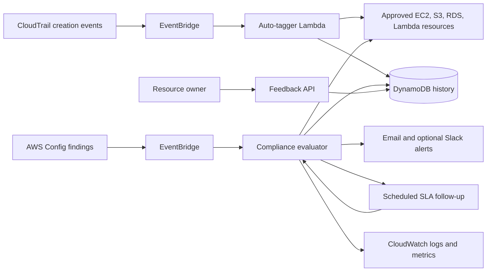

# Red Queen Optimizer

**A tag-governance prototype for AWS teams**

When cloud resources are missing ownership and cost-center tags, teams can struggle to understand who is responsible for spend. Manual follow-up is easy to miss and harder to manage as an environment grows.

Red Queen helps teams apply and check tags on selected AWS resources, notify owners about gaps, and flag unresolved cases for human review. It is designed to improve cost visibility and governance—not to claim automatic cost savings.

## Modeled AWS cost

These are **modeled monthly subtotals, not AWS bills or quotes**. They were recalculated from the assumptions and formulas in the [detailed cost estimate](docs/ESTIMATION_COUTS_AWS.md). The model uses official AWS Price List inputs for **Europe (Paris), `eu-west-3`, checked 15 November 2026**, and **does not include Free Tier benefits**.

| Monitored resources | Estimated subtotal / month |
|---:|---:|
| 1,000 | **$12.91** |
| 10,000 | **$76.86** |
| 100,000 | **$654.44** |

For each 1,000 resources, the model assumes 100 new resources, 4,100 AWS Config rule checks, 1,000 recorded configuration changes, and 100 non-compliance alerts in a 30-day month. It also assumes one follow-up schedule per alert and feedback for one quarter of alerts.

The totals exclude several unknown or customer-dependent charges, including integrated KMS requests, some AWS Config delivery and storage, data transfer, and unverified control-call costs for EC2, RDS, and Lambda. AWS Config recording and rules are external prerequisites. See the [full assumptions, calculations, pricing sources, and exclusions](docs/ESTIMATION_COUTS_AWS.md) before using these figures in a proposal.

## Why it can help

Consistent `Owner`, `Squad`, `CostCenter`, and `Environment` tags can make it easier to group cloud spend, identify responsible teams, and investigate unallocated costs. Automated checks and notifications can also reduce repetitive manual follow-up.

**Illustrative effort calculation—not measured savings:** If a team handles 20 tag follow-ups each month, spending 15 minutes on each, at an assumed loaded labor cost of $40/hour, that work represents 5 hours or **$200/month of labor capacity**. This is only an example of time that might be redirected if the work were reduced. Red Queen has not measured time saved, ROI, or AWS bill reductions.

## How it works

Event-driven serverless services run when events arrive, rather than relying on a continuously running application server. Separate event routes keep new-resource tagging apart from compliance follow-up. Overdue resources receive review tags; Red Queen does not stop or delete them.

## What is implemented

- Tagging and tag checks for **EC2 instances, S3 buckets, RDS database instances, and Lambda functions**.
- Required attribution tags and checks for empty or known placeholder values.
- Notifications, SLA tracking, owner feedback, and governance event history.
- Tag-based quarantine for human review.
- Separate IAM roles and an explicit resource allow-list.

## Local Performance Benchmark

In an offline benchmark, Red Queen tagged **6,000 of 6,000 simulated resources** across five runs each of 200- and 1,000-event workloads, with **0 errors**. P95 latency was **0.217 ms** and **0.184 ms**, with combined throughput of **7,443** and **7,822 events/second**, respectively.

These are local Python measurements using simulated AWS APIs—not AWS service performance. Real AWS latency and throughput remain unknown. See the [benchmark report, reproduction script, and raw results](docs/BENCHMARK_LOCAL.md).

## Scope and limitations

- **Dry-run is enabled by default.** It logs intended actions but skips enforcement writes.
- **`governance_scope` is empty by default.** Workload resources are not in scope until reviewed ARNs are configured.
- CloudTrail and compatible AWS Config rules must be configured separately.
- Real AWS end-to-end integration has **not** been tested. Local tests do not verify live service behavior, permissions, or AWS latency.
- Concurrent events may cause duplicate processing. Concurrent S3 tag updates can overwrite one another because `PutBucketTagging` replaces the bucket's full tag set.
- No financial or AWS cost savings have been demonstrated.

## Technical validation

Latest verified local checks:

- **147 Python tests passed** using offline simulations.
- **7 Terraform scenarios passed** using mocked providers.
- Terraform formatting, validation, lint, and dashboard JSON checks passed.

These results are local validation—not real AWS integration tests or benchmark results. See [local validation and known risks](docs/CORRECTIONS_LOCALES.md) and the [IAM review](docs/IAM_MOINDRE_PRIVILEGE.md).

## License

MIT
