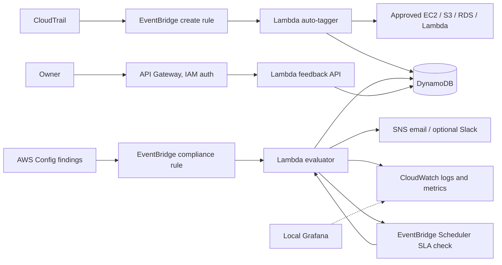

# Red Queen Optimizer

**AWS tag governance prototype | Terraform | Python 3.12**

## Executive summary — STAR

- **Situation:** Missing tags obscure AWS cost ownership.
- **Task:** Improve governance without blocking engineers or deleting resources.
- **Action:** Tag selected resources, process Config findings, notify owners, track an SLA, and flag unresolved resources for review.
- **Result:** A locally tested serverless prototype with scoped IAM and a documented cost model. AWS savings and real-service performance are unmeasured.

## Architecture

CloudTrail and AWS Config are external prerequisites; separate rules isolate creation and compliance events.

## Technical validation

| Check | Result |
|---|---|
| Offline Python tests (pytest/moto, network guard) | **147 passed** |
| Mocked Terraform policy scenarios | **7 passed, 0 failed** |
| Terraform formatting and validation | **Passed** |
| Benchmark / real AWS integration | **Not run** |

Local tests only; no AWS integration results. See [validation limits](docs/CORRECTIONS_LOCALES.md) and [IAM boundaries](docs/IAM_MOINDRE_PRIVILEGE.md).

## Estimated AWS costs

Recalculated model subtotals use official AWS Price List inputs for **Paris (`eu-west-3`)**, checked **15 November 2026**. Headline estimates exclude Free Tier benefits; they are not quotes or observed bills.

| Resources | No Free Tier | Conditional eligible Free Tier* |
|---:|---:|---:|
| 1,000 | **$12.91/month** | about $9.90/month |
| 10,000 | **$76.86/month** | about $73.81/month |
| 100,000 | **$654.44/month** | about $651.07/month |

**Monthly workload assumptions (30-day month):** For every 1,000 monitored resources, the model assumes 100 new resources, 4,100 AWS Config checks, 1,000 recorded configuration changes, and 100 alerts. These events lead to about 350 Lambda runs and one scheduled follow-up for each alert. It also assumes that one quarter of alerts receive feedback through the API (one submission and one lookup each), that DynamoDB records average 1 KiB and remain for 90 days, and that logs are kept for 14 days. The estimate includes up to 16 CloudWatch metric series. These are planning assumptions, not measured usage.

Includes one KMS key-month and the priced operations in the [detailed estimate](docs/ESTIMATION_COUTS_AWS.md). Excludes KMS integration calls, unverified EC2/RDS/Lambda control-call charges, transfer and delivery/storage fees, existing workload costs, support, and taxes. Config recording/rules are external, so incremental costs depend on the customer's setup. Defaults are `eu-west-1`, `dry_run = true`, and empty `governance_scope`; Paris assumes overrides.

*Free Tier figures depend on eligibility and unused shared quotas. The [detailed estimate](docs/ESTIMATION_COUTS_AWS.md) has formulas and official sources; recheck prices and account usage before quoting.

## Business value and decisions

`Owner`, `Squad`, `CostCenter`, and `Environment` tags support cost allocation and ownership reporting. Potential time savings are unmeasured; no AWS savings are demonstrated.

- **Serverless:** event-driven Lambdas and managed services.
- **Least privilege:** separate roles; `governance_scope` is an empty-by-default ARN allow-list.
- **Dry run:** on by default; no enforcement writes.
- **Quarantine:** review tags only; no stop or delete.

## Limitations

Real AWS integration testing in an authorized sandbox is still required. CloudTrail and compatible Config rules are external prerequisites. Concurrent events can duplicate work; concurrent S3 updates can lose tags because `PutBucketTagging` replaces the full set. Quarantine is not remediation or a cost-saving action.

**Further reading:** [cost estimate](docs/ESTIMATION_COUTS_AWS.md) · [IAM review](docs/IAM_MOINDRE_PRIVILEGE.md) · [local validation](docs/CORRECTIONS_LOCALES.md) · [engineering journal](docs/JOURNAL_DE_BORD.md)

## License

MIT
