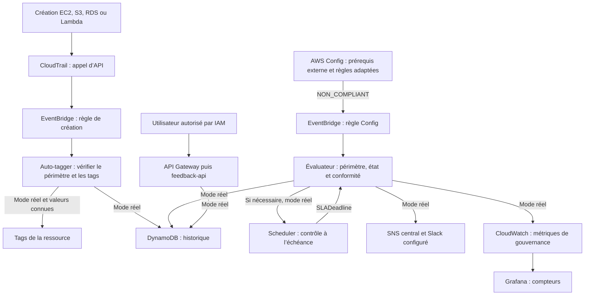
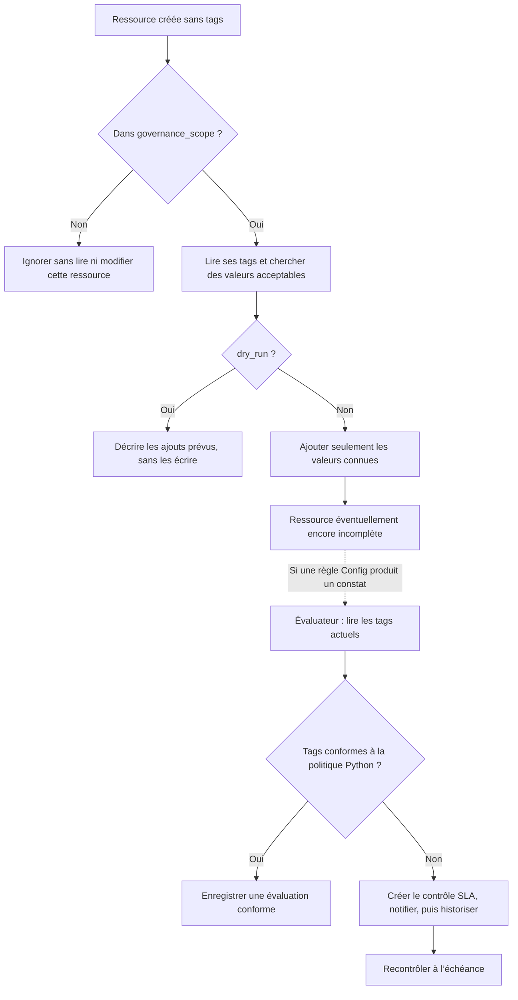
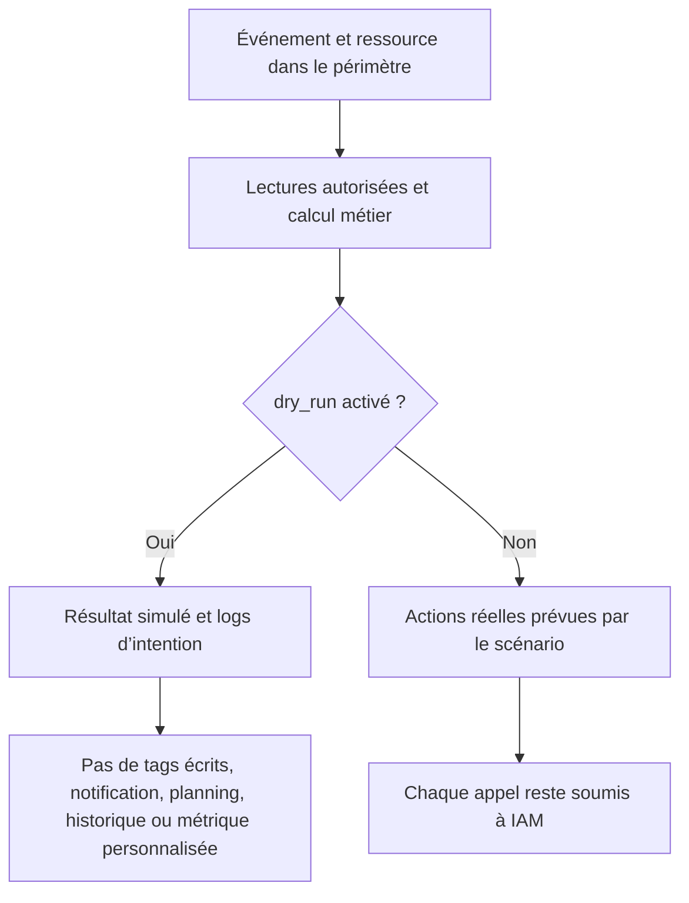
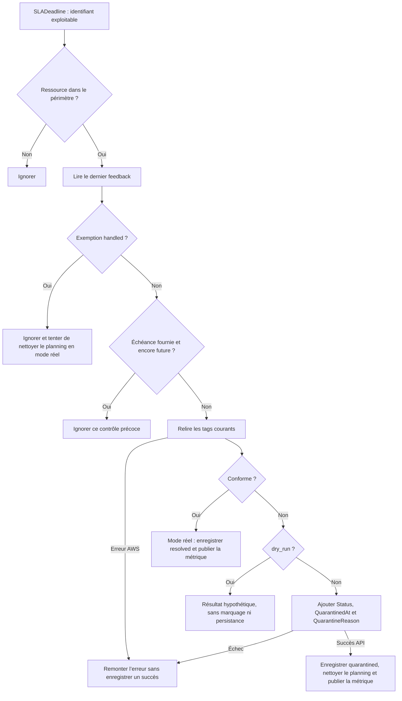
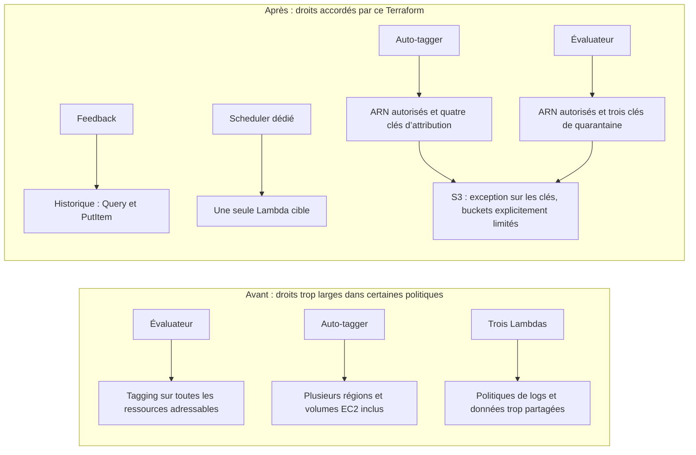

# Comprendre les corrections de Red Queen Optimizer

Documentation d’apprentissage — revue du 15 novembre 2026.

Ce guide explique les changements préparés sur la branche
`fix/local-governance-safety`, par rapport au commit `783ecc8`. Ils sont
maintenant enregistrés dans un commit local. Une **branche Git** est une ligne
de travail distincte ; un **commit** est une version enregistrée.

Les documents [CORRECTIONS_LOCALES.md](CORRECTIONS_LOCALES.md) et
[IAM_MOINDRE_PRIVILEGE.md](IAM_MOINDRE_PRIVILEGE.md) sont conservés. Le premier
décrit le premier lot ; le second, le renforcement des permissions. Ici, nous
relions les changements pour comprendre leur logique et leurs limites.

**Le commit est local : aucun push ni déploiement AWS n’est effectué.**

## Parcours de lecture

1. [Le vocabulaire et le niveau de preuve](#1-les-mots-utiles-et-le-niveau-de-preuve).
2. [Le fonctionnement global](#2-la-vue-densemble).
3. [Les corrections expliquées une par une](#3-les-corrections-expliquees).
4. [Les tests et leurs résultats](#4-comprendre-les-tests-et-les-resultats).
5. [Les risques encore ouverts](#5-ce-qui-reste-a-securiser).
6. [Comment expliquer Red Queen à un recruteur](#6-comment-expliquer-red-queen-a-un-recruteur).
7. [Apprendre dans VS Code et préparer la suite](#7-apprendre-dans-vs-code-et-preparer-la-suite).
8. [Les fichiers et les références](#8-carte-des-fichiers-et-references).

Les exemples de comptes, de personnes et de ressources sont fictifs. Ils
illustrent un comportement attendu ; ce ne sont pas des témoignages de clients.

## 1. Les mots utiles et le niveau de preuve

### 1.1 Un petit dictionnaire avant de commencer

| Terme | Explication simple |
|---|---|
| AWS | Fournisseur de services informatiques à distance, facturés selon leur utilisation. |
| Ressource | Un élément informatique : serveur, espace de stockage, base de données ou fonction. |
| EC2 | Service AWS de serveurs virtuels. Une instance est un serveur de ce service. |
| S3 et bucket | S3 stocke des fichiers appelés objets ; un bucket est leur contenant. |
| RDS | Service de bases de données gérées par AWS. |
| Lambda | Fonction exécutée à la demande par AWS, sans administrer son serveur. |
| Tag | Étiquette `clé=valeur` attachée à une ressource, par exemple `Squad=Paiements`. |
| FinOps | Pratique qui relie dépenses du cloud, équipes et décisions économiques. |
| Gouvernance | Règles, responsabilités et contrôles pour utiliser les ressources correctement. |
| API | Interface permettant à un programme de demander une opération à un service. |
| Événement | Message décrivant quelque chose qui s’est produit. |
| CloudTrail | Journal AWS des appels d’API, comme la création d’un serveur. |
| AWS Config | Service qui enregistre des configurations et évalue leur conformité à des règles. |
| EventBridge | Service qui trie et transmet les événements selon des règles. |
| Scheduler | Service AWS qui appelle une cible à une date ou selon un calendrier. |
| DynamoDB | Base de données AWS utilisée ici pour conserver l’historique de gouvernance. |
| SNS et topic | SNS diffuse des notifications ; un topic est un canal auquel on s’abonne. |
| Webhook Slack | Adresse HTTP à laquelle le programme envoie un message pour un canal Slack. |
| CloudWatch Logs | Journaux d’exécution AWS : ce que le programme raconte de son travail. |
| Métrique | Mesure numérique, par exemple le nombre d’alertes traitées. |
| Grafana | Outil d’affichage des mesures sous forme de tableaux de bord. |
| IAM | Gestion AWS des identités et des autorisations. |
| Rôle et politique IAM | Le rôle est une identité de travail ; sa politique décrit ses droits. |
| ARN | Adresse complète d’une ressource AWS, comparable à une adresse postale. |
| KMS | Service AWS de gestion des clés de chiffrement. |
| Terraform | Outil qui décrit l’infrastructure dans des fichiers et peut la provisionner. |
| JSON | Format de données structuré : objets `{}`, listes `[]`, textes et nombres. |
| SLA | Délai de service convenu. Ici, délai accordé avant le marquage pour revue. |
| TTL | Durée de conservation après laquelle DynamoDB peut supprimer un enregistrement. |

Une **fonction Python** est une petite procédure nommée. Un **gestionnaire**,
ou `handler`, est son point d’entrée quand AWS lui transmet un événement.
`boto3` est la bibliothèque Python qui appelle AWS ; `botocore` fournit notamment
ses mécanismes de communication et ses erreurs. Un **fournisseur Terraform**
est le composant qui connaît les ressources d’un service, par exemple AWS.

### 1.2 Les trois niveaux à ne jamais mélanger

- **Confirmé dans le code** : nous pouvons montrer l’instruction et son fichier.
- **Vérifié localement** : un contrôle ou un test a exécuté un scénario sur la machine,
  avec des services simulés lorsqu’il concerne AWS.
- **À valider sur AWS** : il manque un essai dans un compte réel avec ses autorisations,
  ses délais, ses limites et ses données.

Métaphore : vérifier la recette, cuisiner dans une cuisine d’essai et servir dans
un restaurant complet sont trois étapes différentes. Réussir la deuxième ne
prouve pas que la troisième est prête.

**Résultat récent important :** le 15 novembre 2026, les sept scénarios Terraform
et les **147 tests Python** ont réussi. La section 4 précise les contrôles exécutés
et leurs limites.

## 2. La vue d’ensemble

### 2.1 Red Queen est un responsable des étiquettes

Imaginons un entrepôt. Les ressources AWS sont des colis. Les tags disent à qui
ils appartiennent, pour quelle équipe et sur quel budget. Red Queen tente de
compléter les étiquettes connues, signale les étiquettes manquantes et prépare
une revue humaine si rien n’est corrigé à temps.

Il ne calcule pas aujourd’hui des recommandations de redimensionnement, ne
supprime pas les colis et ne prouve aucune économie réalisée. Une meilleure
attribution des dépenses peut aider à prendre des décisions ; elle ne réduit
pas automatiquement la facture.



Les deux chemins de détection sont **indépendants et asynchrones** : ils ne se
terminent pas nécessairement dans l’ordre de création. Il n’existe pas de flèche
directe de l’auto-tagger vers l’évaluateur. Séparer les règles évite d’envoyer un
même événement aux deux fonctions ; cela ne garantit pas leur ordre d’exécution.
La relecture des tags courants aide à éviter d’agir sur un ancien constat.

### 2.2 Parcours d’une ressource initialement sans tags



La flèche pointillée est volontaire : Red Queen ne crée pas aujourd’hui tous les
prérequis CloudTrail et Config. Sans règle adaptée, la deuxième partie peut ne
jamais démarrer. Avec `governance_scope` vide, on s’arrête dès la première décision.

## 3. Les corrections expliquees

Chaque fiche distingue le comportement initial, sa correction et les preuves
disponibles. Les fichiers sont accessibles depuis les liens et leurs fonctions
peuvent être recherchées avec `Ctrl+F` dans VS Code.

### 3.1 Conserver les tags existants sur S3

**Avant :** `_handle_s3()` lisait les tags existants, mais envoyait seulement les
tags manquants à `put_bucket_tagging()`.

**Le problème :** cette API remplace l’ensemble des tags. Une correction pouvait
donc supprimer `Owner`, `Project` ou d’autres étiquettes déjà correctes.

**Métaphore :** pour ajouter un numéro de téléphone à une fiche client, on remplaçait
la fiche entière par ce numéro, en perdant le nom et l’adresse.

**Après :** le programme fusionne les tags lus et les ajouts :

```python
{**existing, **tags}
```

Les deux dictionnaires Python, sortes de carnets `clé → valeur`, deviennent un
ensemble unique. Pour une clé commune, la valeur de droite l’emporte.

**Explication technique :** voir [`_handle_s3()`](../lambdas/auto-tagger/handler.py).
Le chemin de quarantaine S3 fusionnait déjà ses tags ; cette conservation n’est
donc pas une nouvelle correction de ce second chemin. La sémantique de remplacement
est décrite dans [l’API S3](https://docs.aws.amazon.com/AmazonS3/latest/API/API_PutBucketTagging.html).

**Exemple concret :** un bucket fictif possède `Project=apollo` et
`Environment=prod`. Ajouter `Owner=alice@example.com` conserve ces deux valeurs.
Les tags encore inconnus restent manquants.

**Test :** `test_s3_preserves_tags_and_reports_actual_state` vérifie avec S3 simulé
la conservation des tags, les ajouts réels et l’absence d’écriture en simulation.

**Limites :** la séquence lire–fusionner–écrire n’est pas indivisible. Une autre
personne peut changer les tags entre la lecture et l’écriture. Ce risque de
concurrence n’est pas corrigé. Les formats de buckets S3 particuliers ne sont
pas validés dans un compte AWS réel.

### 3.2 Refuser les étiquettes qui ne renseignent rien

**Avant :** `check_required_tags()` vérifiait la présence des clés. Une clé
`CostCenter` présente avec une valeur vide ou `CC-000` suffisait.

**Le problème :** les contrôles annonçaient une conformité sans attribution utile.

**Métaphore :** un formulaire avec « à compléter » dans chaque case n’est pas un
formulaire correctement rempli, même si toutes les cases contiennent du texte.

**Après :** `is_placeholder_value()` refuse les valeurs non textuelles, les valeurs
vides et la liste de remplissage définie dans `PLACEHOLDER_TAG_VALUES`. Les espaces
autour et les différences de majuscules sont ignorés pour cette comparaison.

**Explication technique :** [`constants.py`](../lambdas/shared/constants.py) contient
la politique ; [`utils.py`](../lambdas/shared/utils.py) l’applique à chaque tag
obligatoire. `Unknown`, ` UNKNOWN ` et `unknown` sont ainsi équivalents pour le refus.

**Exemple concret :** `Owner=alice@example.com`, `Squad=unknown`,
`CostCenter=CC-000`, `Environment=prod` donne deux tags à renseigner :
`Squad` et `CostCenter`.

**Test :** `test_filler_values_are_missing` et `test_real_values_are_accepted`
vérifient plusieurs valeurs, dont `CC-0001`, qui ne doit pas être confondu avec `CC-000`.

**Limites :** une valeur acceptée n’est pas nécessairement vraie. Le programme
n’interroge pas un annuaire d’équipes ni un référentiel comptable. La liste de
valeurs interdites devra être adaptée si un client utilise légitimement `CC-000`.
Une règle Config vérifiant seulement les clés peut encore accepter ces valeurs.

### 3.3 Choisir une valeur connue plutôt qu’inventer un propriétaire

**Avant :** les valeurs par défaut comprenaient `unknown`, `CC-000` et une adresse
générique. Une valeur fictive fournie dans une requête pouvait aussi masquer
l’identité exploitable du créateur.

**Le problème :** l’auto-tagger fabriquait lui-même une conformité trompeuse.

**Métaphore :** ne pas savoir à qui appartient une valise ne justifie pas
d’inscrire le nom du réceptionniste sur son étiquette.

**Après :** Owner, Squad et CostCenter sont vides par défaut. `_first_real_value()`
retient la première valeur qui passe la politique : pour Owner, valeur de requête,
identité déduite du créateur, puis valeur configurée. Les valeurs fictives sont sautées.

**Explication technique :** `_build_defaults()` et `_compute_missing_tags()` dans
[`auto-tagger/handler.py`](../lambdas/auto-tagger/handler.py), avec
[`variables.tf`](../infra/variables.tf) et
[`terraform.tfvars.example`](../infra/terraform.tfvars.example).

**Exemple concret :** la requête contient `Owner=unknown`, mais le créateur est
identifiable par `alice@example.com`. Alice devient la valeur candidate. Si aucune
valeur acceptable n’existe pour Squad, cette étiquette n’est pas ajoutée.

**Test :** `test_request_filler_falls_back_to_creator` couvre ce choix ;
`test_no_defaults_does_not_claim_compliance` couvre l’absence de valeurs exploitables.

**Limites :** le nom d’une session IAM contenant une adresse n’est pas une preuve
d’identité métier suffisante. `Environment` conserve une valeur par défaut liée
au déploiement ; cela peut être une mauvaise hypothèse pour un compte mixte.

### 3.4 Distinguer une intention d’un effet réel

**Avant :** `tags_added` pouvait contenir des clés non écrites, en simulation ou
après erreur. Un ajout réussi pouvait aussi laisser `compliant=False` sans distinction.

**Le problème :** un lecteur de l’historique ne pouvait pas savoir ce qui avait
réellement changé.

**Métaphore :** une liste de courses n’est pas un ticket de caisse.

**Après :** `_apply_tags()` sépare trois notions :

| Champ | Sens exact |
|---|---|
| `tags_planned` | Clés que l’on sait proposer pour cette exécution. |
| `tags_added` | Clés dont l’écriture a été effectuée sans erreur renvoyée. |
| `tags_unresolved` | Clés encore absentes ou fictives dans l’état calculé après l’action. |

Le résultat peut être `already_compliant`, `needs_owner`, `dry_run` ou `tagged`.
`tagged` ne signifie pas forcément que les quatre tags sont devenus conformes.

**Explication technique :** voir `_apply_tags()` et `put_governance_record()`.
La conformité est recalculée à partir des tags lus et des ajouts effectivement
réalisés. En cas d’exception d’écriture, la fonction ne produit pas ce compte rendu de succès.

**Exemple concret :** ajouter Owner tout en ignorant Squad et CostCenter inconnus
donne `tagged`, `tags_added=["Owner"]` et des tags encore non résolus.

**Test :** les tests S3 et `test_auto_tagging_other_services_with_real_shared_helpers`
couvrent ces résultats ; `test_failed_tagging_is_retried_instead_of_persisting_success`
vérifie qu’un échec remonte, sans enregistrer un succès.

**Limites :** il n’y a pas de relecture de contrôle après chaque écriture.
« Ajouté » signifie que l’API n’a pas renvoyé d’erreur, pas qu’une vérification
indépendante a confirmé l’état final après d’éventuelles modifications concurrentes.

### 3.5 Faire du dry-run une répétition sans modification applicative

**Avant :** `dry_run` évitait certaines écritures de tags et de plannings,
mais la persistance DynamoDB, les notifications et les métriques pouvaient partir.

**Le problème :** une répétition pouvait enregistrer une exemption ou envoyer une
alerte réelle. Le mot « simulation » donnait une assurance trop forte.

**Métaphore :** une répétition d’évacuation ne doit pas appeler automatiquement
les secours comme si le bâtiment brûlait réellement.

**Après :** les trois fonctions continuent à lire ce dont elles ont besoin, puis
décrivent les intentions. Les écritures de tags, DynamoDB, SNS/Slack, les plannings
et les métriques de gouvernance sont bloqués dans les chemins applicatifs de simulation.



**Explication technique :** `_apply_tags()`, `_send_alert()`,
`_handle_compliance_event()`, `_handle_sla_deadline()`,
`put_governance_record()` et `put_governance_metric()` contiennent les protections.
La réponse de feedback indique aussi `dry_run`.

**Exemple concret :** `approve` en simulation peut répondre `new_status=handled`
avec `dry_run=true`, mais aucune exemption n’est écrite dans DynamoDB.
De même, une réponse `quarantined` accompagnée de `dry_run=true` n’est pas la
preuve qu’un marquage a été effectué.

**Test :** `test_dry_run_has_no_persistence_notification_scheduler_or_metric`,
`test_feedback_dry_run_does_not_create_an_exemption` et les tests paramétrés des
quatre services vérifient les effets interdits avec des services simulés.

**Limites :** le mode réel des API AWS n’a pas été testé ici. Les lectures et
l’exécution Lambda peuvent être facturées ; les logs et métriques natifs Lambda
peuvent exister. `scripts/publish_demo_metrics.py` écrit volontairement dans
CloudWatch et ne fait pas partie de cette protection. Un dry-run ne valide pas
les autorisations d’écriture puisqu’il ne les utilise pas.

### 3.6 Envoyer les événements CloudTrail à la bonne porte

**Avant :** la règle Terraform filtrait `source=aws.cloudtrail` pour les créations
EC2, S3, RDS et Lambda.

**Le problème :** le transport d’un appel par CloudTrail ne remplace pas son
service d’origine par `aws.cloudtrail`. Le filtre pouvait écarter les événements utiles.

**Métaphore :** recevoir une lettre par La Poste ne signifie pas que son expéditeur
est « La Poste ». Chercher uniquement ce nom dans la case expéditeur rate les clients.

**Après :** `cloudtrail_creates` sélectionne `aws.ec2`, `aws.s3`, `aws.rds` et
`aws.lambda`, avec le type `AWS API Call via CloudTrail` et les noms d’appels attendus.

**Explication technique :** [`eventbridge.tf`](../infra/eventbridge.tf) route les
créations vers l’auto-tagger seulement. `WATCHED_EVENTS` et `_dispatch()` choisissent
le gestionnaire Python. Pour EC2, les identifiants créés sont lus dans la réponse.
Le service source est illustré dans [la référence AWS EC2](https://docs.aws.amazon.com/eventbridge/latest/ref/events-ref-ec2.html).

**Exemple concret :** un `RunInstances` avec `source=aws.ec2` peut désormais
correspondre à la règle, à condition que CloudTrail et EventBridge soient correctement configurés.

**Test :** le filtre est confirmé par lecture et Terraform valide sa configuration.
Les tests d’auto-tagging exécutent des événements simulés. Aucun test local ne
prouve la livraison CloudTrail réelle ni tous les détails du filtrage EventBridge.

**Limites :** CloudTrail reste un prérequis externe. Les événements perdus ou
retardés, les différents formats réels et les créations par différents outils
doivent être vérifiés sur AWS. La séparation des règles ne crée pas une garantie d’ordre.

### 3.7 Supporter des sections absentes dans un événement de création

**Avant :** le programme supposait souvent que `requestParameters` ou
`responseElements` était un objet. Un JSON `null` devenait `None` en Python,
qui ne possède pas la méthode `.get()` d’un dictionnaire.

**Le problème :** un événement incomplet pouvait provoquer une exception sans
apporter de ressource exploitable. Une création échouée ne devait pas être traitée comme réussie.

**Métaphore :** une enveloppe vide ne doit pas être traitée comme un formulaire rempli.

**Après :** l’entrée de l’auto-tagger normalise trois sections vides en `{}` et
ignore une création portant `errorCode`. Sans identifiant exploitable, les
gestionnaires retournent un résultat vide.

**Explication technique :** `lambda_handler()` dans
[`auto-tagger/handler.py`](../lambdas/auto-tagger/handler.py) utilise `value or {}`
pour les sections de premier niveau concernées.

**Exemple concret :** une requête `CreateBucket` sans paramètres utilisables ne
déclenche pas de tentative de tagging d’un bucket au nom vide.

**Test :** `test_null_cloudtrail_sections_are_safe` couvre les quatre noms de
création avec des sections `null`. La branche `errorCode` est présente dans le
code, sans test dédié démontrant ici tous ses cas.

**Limites :** ce n’est pas une validation complète de tous les schémas possibles.
Des valeurs de mauvais type et certains objets imbriqués à `null` restent à couvrir.

### 3.8 Lire le vrai chemin d’identification AWS Config

**Avant :** `_extract_event_fields()` attendait surtout un `configurationItem`
contenant identifiant, type et tags.

**Le problème :** le flux sélectionné par Terraform est un changement de conformité.
Son résultat utilise un autre chemin d’identification et ne fournit pas forcément les tags courants.

**Métaphore :** une alarme incendie donne le numéro du bâtiment ; elle ne contient
pas l’inventaire actualisé de toutes ses pièces. Il faut retrouver le bâtiment, puis vérifier.

**Après :** le parseur lit :

```text
detail
  → newEvaluationResult
  → evaluationResultIdentifier
  → evaluationResultQualifier
  → resourceId / resourceType
```

Si la ressource est dans le périmètre, `_fetch_current_tags()` appelle le service
concerné. Le format historique `configurationItem` reste supporté.

**Explication technique :** voir `_extract_event_fields()`,
`_normalise_config_type()` et `_fetch_current_tags()` dans
[`compliance-evaluator/handler.py`](../lambdas/compliance-evaluator/handler.py).
Le chemin est documenté dans [l’exemple de notification Config AWS](https://docs.aws.amazon.com/config/latest/developerguide/example-config-rule-compliance-notification.html).

**Exemple concret :** Config signale un EC2 non conforme, mais Alice vient d’ajouter
les tags. Relire l’état courant peut permettre d’enregistrer une évaluation conforme
au lieu d’ouvrir une nouvelle alerte sur l’ancien état.

**Test :** `test_real_config_shape_fetches_live_tags` vérifie ce chemin et l’appel
de lecture avec une réponse substituée. `test_unlisted_config_event_is_skipped_before_reading_tags`
vérifie que les ressources hors liste ne sont pas lues.

**Limites :** le nom du test signifie « forme représentative du message réel »,
pas « test exécuté dans AWS ». Les identifiants réellement fournis pour chaque
type, notamment RDS, leur conversion en ARN et les autorisations de lecture restent à valider.

### 3.9 Ne pas remettre le compteur SLA à zéro à chaque répétition

**Avant :** chaque nouveau traitement d’un constat pouvait notifier à nouveau,
calculer une nouvelle échéance et tenter de créer un planning de même nom.

**Le problème :** les événements peuvent être répétés. Un délai enregistré pouvait
alors différer de celui du planning déjà actif. Des alertes répétées deviennent aussi du bruit.

**Métaphore :** recevoir deux copies d’une facture ne doit pas repousser son
échéance ni déclencher deux paiements.

**Après :** si le dernier enregistrement est `alerted` et contient `sla_deadline`,
une répétition séquentielle est ignorée avec `reason=already_alerted`. Lors d’une
reprise avant cette persistance, un conflit de création Scheduler conduit à lire
le planning existant et à reprendre son échéance, après vérification d’identité.

**Explication technique :** `_handle_compliance_event()` et `_schedule_sla_check()`.
C’est une amélioration partielle de l’**idempotence** : refaire une opération ne
devrait pas en multiplier les effets. Le planning est désormais créé avant les
notifications et l’enregistrement `alerted`, afin de ne pas annoncer une alerte
complète sans avoir réussi à programmer son contrôle.

**Exemple concret :** un constat traité à 9 h fixe une échéance. Sa copie de 9 h 05
ne doit pas rajouter cinq minutes. Les règles présentes donnent 36 h aux ressources
critiques et 168 h aux autres ; ces durées existaient déjà avant les corrections.

**Test :** `test_repeat_event_keeps_original_sla_and_does_not_notify` et
`test_scheduler_retry_reuses_original_deadline` vérifient deux cas séquentiels.

**Limites :** deux exécutions simultanées peuvent toutes deux lire « aucune alerte ».
Un crash après l’envoi SNS mais avant DynamoDB peut produire un nouvel envoi à la
reprise. Un autre événement peut aussi devenir le dernier enregistrement et
masquer `alerted`. Il n’existe ni verrou transactionnel ni garantie « exactement une fois ».

### 3.10 Fabriquer des plannings valides et éviter un contrôle trop précoce

**Avant :** le code gardait 64 caractères de l’identifiant puis ajoutait `rq-sla-` :
le nom pouvait atteindre 71 caractères. Remplacer les caractères spéciaux pouvait
aussi rendre identiques deux noms distincts. Les fractions de seconde étaient tronquées.

**Le problème :** un nom trop long peut être refusé. Un nom partagé peut viser
le mauvais incident. Tronquer 12:00:00,800 à 12:00:00 peut programmer un contrôle
avant l’échéance enregistrée.

**Métaphore :** deux patients ne doivent pas recevoir le même numéro de rendez-vous,
et un réveil ne doit pas sonner avant l’heure qui sert à décider d’une sanction.

**Après :** `_schedule_name()` conserve les identifiants simples suffisamment
courts ; sinon, il ajoute un **condensat SHA-256**, une empreinte calculée du texte,
sur une partie tronquée. Le nom reste au maximum de 64 caractères. L’heure de
déclenchement est arrondie vers la seconde supérieure si nécessaire.

**Explication technique :** `_schedule_sla_check()` place l’échéance complète dans
le message. `_handle_sla_deadline()` ignore un contrôle si cette échéance est fournie
et encore future. `ActionAfterCompletion="DELETE"` demande le nettoyage du planning.

**Exemple concret :** `a:b` et `a/b` ne sont plus simplement transformés en un même
nom `a-b`. Une échéance avec microsecondes ne produit pas une expression programmée
avant cette échéance.

**Test :** `test_schedule_names_respect_length_and_avoid_sanitization_collisions`
et `test_scheduler_retry_reuses_original_deadline`, qui compare aussi les dates.
L’ancien test de longueur, trop permissif, a été ramené à 64.

**Limites :** un condensat tronqué diminue fortement les collisions sans constituer
une preuve mathématique d’unicité. Le nom ne porte toujours pas un identifiant
unique d’incident. Le délai réel de livraison Scheduler n’a pas été mesuré.
Un ancien message sans échéance ne bénéficie pas du garde-fou temporel.

### 3.11 Respecter les exemptions avant de marquer une ressource

**Avant :** le traitement initial consultait un dernier statut, mais le traitement
SLA ne vérifiait pas le feedback d’exemption avant de poser la quarantaine.

**Le problème :** une ressource approuvée comme exception pouvait être marquée
plus tard comme si cette décision n’avait jamais existé.

**Métaphore :** un véhicule dispose d’une autorisation spéciale ; l’agent doit
consulter cette autorisation avant de déposer un avis d’infraction.

**Après :** le traitement initial et le contrôle SLA recherchent le dernier événement
`feedback`. S’il porte `status=handled`, ils n’appliquent pas la quarantaine.
À l’échéance, le code tente également de supprimer le planning si son nom est fourni.



Le chemin `resolved` ne persiste ni ne publie de métrique en simulation ; les
garde-fous communs s’appliquent aussi à cette branche.

**Explication technique :** `_handle_sla_deadline()`,
`get_governance_record(..., event_filter="feedback")` et `_apply_quarantine_tags()`.
La quarantaine ajoute seulement `Status=needs-review`, `QuarantinedAt` et
`QuarantineReason=missing_required_tags`. Cette approche non destructive existait
déjà ; la correction renforce le respect des décisions et le traitement des échecs.

**Exemple concret :** un bac de données exempté pour une expérimentation conserve
son état après `approve`, même si un événement d’auto-tagging est plus récent que le feedback.

**Test :** `test_approved_resource_is_not_quarantined_even_after_auto_tag_record`
vérifie ce cas avec DynamoDB simulé. Les tests existants couvrent aussi des marquages EC2,
S3 et Lambda simulés.

**Limites :** l’API n’annule pas immédiatement le planning lors d’un `approve`.
Le dernier feedback peut être remplacé, expirer avec le TTL ou être victime d’une
collision de clé : voir section 4. Le contrôle et la décision ne sont pas atomiques.
La quarantaine n’isole aucun réseau, n’arrête rien et n’économise pas d’argent à elle seule.

### 3.12 Chercher un feedback au-delà de la première page DynamoDB

**Avant :** la recherche filtrée examinait au maximum vingt éléments, sans poursuivre
si le feedback recherché était plus ancien.

**Le problème :** DynamoDB applique sa limite aux éléments examinés avant le filtre.
Une page vide après filtrage ne signifie donc pas nécessairement « aucun feedback ».

**Métaphore :** ne pas trouver un contrat sur les vingt premières feuilles d’un
classeur ne prouve pas qu’il n’existe pas dans les suivantes.

**Après :** `get_governance_record()` suit `LastEvaluatedKey` pour lire les pages
suivantes jusqu’à trouver un résultat ou atteindre la fin. `ConsistentRead=True`
demande une lecture cohérente de la table : elle vise à voir les écritures achevées,
sans transformer la lecture et la décision ultérieure en transaction unique.

**Explication technique :** [`utils.py`](../lambdas/shared/utils.py), fonction
`get_governance_record()`, utilise `Query`, le tri décroissant `ScanIndexForward=False`
et `ExclusiveStartKey` pour continuer la lecture.

**Exemple concret :** une exemption suivie de vingt-cinq événements devrait
rester retrouvable si tous ces événements ont été conservés sous des clés distinctes.

**Test :** `test_feedback_query_paginates_past_twenty_newer_records` est précisément
le scénario concerné. Il avait réussi lors de l’exécution précédente ; il échoue
dans la nouvelle exécution de cette documentation. L’investigation montre un
autre défaut possible en amont : des écritures rapides peuvent écraser des événements.

**Limites :** la boucle de pagination est présente, mais on ne peut pas affirmer
que l’exemption est toujours conservée. La conservation et la recherche sont deux
problèmes différents. Le test doit aussi garantir des clés distinctes pour isoler
la pagination, lors d’une future mission autorisant la modification du code et des tests.

### 3.13 Ne plus transformer une erreur AWS en absence de tags

**Avant :** plusieurs lecteurs de tags renvoyaient `{}` ou `[]` après une erreur.
Certaines écritures échouées étaient journalisées puis suivies d’un résultat positif.

**Le problème :** « je n’ai pas pu vérifier » devenait « j’ai vérifié et rien n’est
renseigné ». Cela pouvait déclencher une mauvaise décision ou masquer un travail non effectué.

**Métaphore :** un lecteur de badge en panne ne prouve pas que la personne n’a
pas de badge. Le contrôleur doit signaler la panne.

**Après :** les erreurs de lecture et d’écriture importantes remontent au gestionnaire.
Une erreur de tagging ne devient pas un succès historisé. Un échec de canal de
notification configuré fait aussi échouer `_send_alert()`.

**Explication technique :** lecteurs `_get_ec2_tags()`, `_get_rds_tags()`,
`_get_lambda_tags()`, `_fetch_current_tags()`, écriture `_apply_quarantine_tags()`
et accès DynamoDB relèvent leurs exceptions. Une **exception** est le signal Python
qu’une opération n’a pas pu se terminer normalement. `NoSuchTagSet` reste un cas
particulier S3 signifiant une absence de tags, distincte d’un refus `AccessDenied`.

**Exemple concret :** si IAM refuse la lecture des tags d’un serveur, Red Queen
ne doit pas l’enregistrer comme « mis en quarantaine » après une lecture fictivement vide.

**Test :** `test_aws_tag_read_failure_is_not_interpreted_as_missing_tags`,
`test_failed_quarantine_does_not_record_success`,
`test_notification_failure_is_not_reported_as_success` et le test d’écriture
d’auto-tagging échouée vérifient plusieurs erreurs simulées.

**Limites :** remonter une exception permet les mécanismes de reprise, sans prouver
qu’ils réussiront. `_delete_schedule()` journalise encore certaines erreurs sans
les relancer. Les métriques restent non bloquantes et leur échec peut laisser un
trou dans le tableau de bord. Un identifiant invalidé ou une table non configurée
peut encore conduire les utilitaires à ne rien écrire. Une notification acceptée
par SNS ne prouve pas qu’un humain a reçu ou lu son courriel.

### 3.14 Donner à chaque rôle les seules clés utiles : IAM

**Avant :** l’évaluateur pouvait poser ses tags sur `Resource="*"`, les droits
d’auto-tagging dépassaient la région de déploiement, et les politiques de données
et de logs étaient trop communes.

**Le problème :** un bug ou une compromission disposait d’un périmètre trop large.
Un **périmètre d’impact** est l’ensemble des ressources qu’une erreur peut affecter.

**Métaphore :** l’employé chargé d’étiqueter un rayon recevait le passe-partout
de l’entrepôt. Le moindre privilège lui donne les clés de son rayon et les gestes
autorisés pour sa tâche.

**Après :** les rôles d’exécution restent distincts ; leurs politiques sont resserrées
sur les opérations, les ARN et, lorsque compatible, les clés de tags nécessaires.
Le feedback n’a pas de droit de modification des ressources métier.



**Explication technique :** [`iam.tf`](../infra/iam.tf) définit notamment
`workload_writes`, `resource_reads`, `ec2_reads`, `logs_policies` et `dynamodb_policies`.
`aws:TagKeys` autorise les quatre clés d’attribution pour l’auto-tagger et les trois
clés de quarantaine pour l’évaluateur sur EC2, RDS et Lambda.
`ForAllValues:StringEquals` vérifie toutes les clés ; `Null=false` impose leur présence.

**Exemple concret :** avec ces politiques, l’évaluateur n’est pas autorisé à modifier
`CostCenter` sur une instance EC2, même si cette instance est dans la liste autorisée.
C’est une intention de sécurité vérifiée dans les politiques générées, pas une
décision d’autorisation réelle déjà observée sur AWS.

**Test :** le scénario Terraform `scoped_permissions_and_separation` inspecte les
politiques produites, les actions retirées et les deux listes de clés.

**Limites :** il ne simule pas intégralement le moteur d’autorisation IAM. Les autres
politiques attachées par un administrateur, les politiques de ressource ou d’organisation
peuvent intervenir. Les permissions réelles doivent être validées sur un compte de test.

### 3.15 Choisir les ressources avec governance_scope

**Avant :** il n’y avait pas de liste explicite commune à Terraform et au code pour
limiter les ressources métier gérées.

**Le problème :** installer l’outil risquait de lui donner une portée implicite trop large.

**Métaphore :** un prestataire doit recevoir une liste des appartements à visiter,
pas décider que toute la résidence lui appartient.

**Après :** `governance_scope` contient quatre listes d’ARN, toutes vides par défaut :

```hcl
governance_scope = {
  ec2_instance_arns     = []
  s3_bucket_arns        = ["arn:aws:s3:::bucket-exemple-approuve"]
  rds_db_arns           = []
  lambda_function_arns = []
}
```

Cet exemple ne rend éligible que le bucket fictif nommé. Il ne configure pas une
règle AWS Config et ne donne aucun accès aux objets du bucket.

**Explication technique :** [`variables.tf`](../infra/variables.tf) vérifie les types
d’ARN. `scope_in_deployment` et les préconditions IAM refusent les ARN EC2/RDS/Lambda
d’un autre compte ou région. [`lambdas.tf`](../infra/lambdas.tf) transmet les listes
en JSON dans `GOVERNANCE_SCOPE`, ainsi que compte et région.
`resource_in_governance_scope()` filtre avant les lectures et actions sur les ressources.

**Exemple concret :** une entreprise autorise son bucket de démonstration, pas
celui de production. Un événement hors liste est ignoré par le programme. Si ce
filtre était retiré, les politiques IAM resteraient la barrière de sécurité.

**Test :** les scénarios Terraform `empty_scope_grants_no_workload_access`,
`reject_cross_account_workloads`, `reject_cross_region_workloads`,
`reject_global_s3_wildcard` et `reject_wrong_resource_type` vérifient les garde-fous.
Les tests Python `test_scope_accepts_only_listed_arns` et ceux des événements hors
liste vérifient le filtrage avant appel AWS.

**Limites :** les jokers `*` et `?` dans les suffixes de noms permettent une extension
volontaire. S3 n’encode ni compte ni région dans son ARN : IAM ajoute une condition
de compte propriétaire, mais il faut encore choisir les bons buckets régionaux.
Sans variable `GOVERNANCE_SCOPE`, le Python conserve son ancien comportement pour
compatibilité locale ; Terraform fournit toujours la variable, même vide.
Les ARN construits utilisent la partition commerciale `arn:aws`, sans prétendre
prendre en charge les autres partitions AWS.

### 3.16 Limiter DynamoDB et ses recherches

**Avant :** les trois rôles partageaient `PutItem`, `GetItem` et `Query`, alors que
l’auto-tagger n’a besoin que d’écrire et que le code ne se sert pas de `GetItem`.

**Le problème :** des accès inutiles étaient accordés à l’historique, qui peut
contenir propriétaires, commentaires et identifiants de ressources.

**Métaphore :** une personne chargée de déposer un formulaire dans une boîte
n’a pas automatiquement besoin de lire toutes les archives de cette boîte.

**Après :** l’auto-tagger reçoit seulement `dynamodb:PutItem`. L’évaluateur et le
feedback reçoivent `PutItem` et `Query`. Toutes ces permissions visent l’ARN de
la seule table de gouvernance.

**Explication technique :** `dynamodb_policies` dans [`iam.tf`](../infra/iam.tf)
fait correspondre rôle et actions utilisées par les utilitaires. Le besoin de
déchiffrement est traité séparément dans la fiche KMS.

**Exemple concret :** une erreur introduisant une recherche DynamoDB dans
l’auto-tagger devrait être refusée par les politiques fournies, plutôt que
d’exposer discrètement tout l’historique.

**Test :** `scoped_permissions_and_separation` compare les listes d’actions générées.
Les tests d’intégration simulée utilisent les vraies fonctions de persistance ;
ils n’évaluent toutefois pas les politiques IAM contre un serveur DynamoDB réel.

**Limites :** `Query` reste une lecture des événements de la table selon le code
appelant ; il n’existe pas d’isolation de clients distincts dans cette même table.
Le schéma d’historique et ses collisions ne sont pas corrigés par une politique IAM.

### 3.17 Isoler les journaux et borner les métriques

**Avant :** la politique de logs commune couvrait les groupes Lambda du préfixe
du projet. Chaque fonction pouvait donc disposer de droits d’écriture chez ses voisines.

**Le problème :** des logs attribués à une autre fonction pourraient brouiller une enquête.

**Métaphore :** chaque agent doit écrire dans son cahier de bord, pas dans celui
de tous les collègues.

**Après :** `logs_policies` calcule un ARN de flux propre au groupe de chaque Lambda,
avec seulement `CreateLogStream` et `PutLogEvents`. Les groupes étaient déjà
précréés par Terraform ; les rôles n’ont pas besoin de `CreateLogGroup`.

**Explication technique :** [`iam.tf`](../infra/iam.tf) et
[`observability.tf`](../infra/observability.tf). Un **flux de logs** est une suite
de messages au sein d’un groupe. Pour `PutMetricData`, le namespace
`RedQueen/Governance` était déjà limité ; la condition de région a été ajoutée.
Un namespace est le dossier logique des métriques.

**Exemple concret :** l’auto-tagger écrit ses propres messages sans pouvoir
écrire dans le groupe de l’API feedback avec les politiques accordées ici.

**Test :** `scoped_permissions_and_separation` vérifie les limites de logs ;
les assertions de politiques encadrent les usages nécessaires de `Resource="*"`.

**Limites :** les API EC2 Describe et CloudWatch PutMetricData nécessitent encore
un joker de ressource. Leurs autres conditions limitent la portée. Les lectures
EC2 autorisées peuvent voir des métadonnées de la région au-delà des ARN listés.
Le dashboard compte des événements, pas automatiquement des ressources uniques
ni des économies. Les panneaux Grafana n’ont pas été redessinés.

### 3.18 Donner à KMS une clé et un contexte précis

**Avant :** les rôles partageaient notamment une permission de génération de clés
de données et de déchiffrement sans distinguer suffisamment l’usage DynamoDB de SNS.
Le service Logs pouvait utiliser la clé pour un contexte très large du compte.

**Le problème :** autoriser une clé sans préciser pourquoi elle est utilisée
élargit inutilement les possibilités de déchiffrement.

**Métaphore :** un coffre ne doit pas s’ouvrir simplement parce que le demandeur
possède une clé ; il faut aussi vérifier le dossier qu’il est venu consulter.

**Après :** l’accès d’exécution DynamoDB est réduit à `kms:Decrypt`, sur la clé du
projet, avec `kms:ViaService` et le contexte du compte et de la table. L’évaluateur
possède séparément les droits nécessaires aux notifications SNS chiffrées,
avec le contexte du topic. La politique de clé limite Logs aux quatre groupes du projet.

**Explication technique :** `dynamodb_decrypt` et `EncryptGovernanceNotifications`
dans [`iam.tf`](../infra/iam.tf), plus [`kms.tf`](../infra/kms.tf).
Le **contexte de chiffrement** est un ensemble d’informations non secrètes liées
à l’opération. `kms:ViaService` conditionne l’usage au service intermédiaire attendu.
La gestion administrative de la clé et des autorisations durables de DynamoDB
reste distincte des opérations des Lambdas.

**Exemple concret :** le rôle feedback ne reçoit pas une permission générale de
déchiffrer n’importe quel contenu avec la clé ; l’usage prévu est la table de gouvernance.

**Test :** `scheduler_kms_and_invocation_boundaries` inspecte les conditions de
service, de table, de topic et les quatre groupes de logs.

**Limites :** ces assertions ne prouvent pas que KMS acceptera tous les appels
réels des services. Il faut tester la chaîne DynamoDB et la publication SNS chiffrée.
La politique administrative du compte conserve `kms:*` sur cette clé pour ne pas
verrouiller son administration ; aucun rôle Lambda ne reçoit `kms:*`.
Un `Resource="*"` dans la politique de cette clé désigne cette clé dans son contexte,
et ne doit pas être confondu avec un droit de rôle sur toutes les clés du compte.

### 3.19 Réserver Scheduler au groupe du projet

**Avant :** l’évaluateur gérait les plannings du groupe `default` sans préfixe
de projet dans la permission. La confiance du rôle Scheduler n’était pas liée à
un groupe et un compte source précis.

**Le problème :** un domaine de planification partagé rend les responsabilités
plus floues et les droits plus larges.

**Métaphore :** le secrétaire de l’équipe Paiements gère son agenda, pas tous
les rendez-vous de l’entreprise. Son badge ne doit pas être prêté à un autre établissement.

**Après :** Terraform crée le groupe `${project}-${environment}-sla`.
L’évaluateur gère seulement ses plannings `rq-sla-*`. Le rôle d’exécution peut
invoquer uniquement la Lambda évaluatrice et fait confiance au compte et au groupe précis.

**Explication technique :** `scheduler_group`, `scheduler_prefix`,
`scheduler_trust_policy`, `PassSchedulerRole` et `scheduler_invoke_lambda` dans
[`iam.tf`](../infra/iam.tf), ressource `aws_scheduler_schedule_group.sla` dans
[`eventbridge.tf`](../infra/eventbridge.tf), variable d’environnement
`SCHEDULER_GROUP_NAME` dans [`lambdas.tf`](../infra/lambdas.tf).
`iam:PassRole` autorise à transmettre ce rôle seulement à Scheduler.

La **politique de confiance** dit qui peut utiliser le rôle ; la politique de
permissions dit ce que ce rôle peut faire. AWS demande un ARN de **groupe** dans
cette condition de confiance, pas l’ARN d’un planning individuel.
[Référence Scheduler](https://docs.aws.amazon.com/scheduler/latest/UserGuide/cross-service-confused-deputy-prevention.html).

**Exemple concret :** Red Queen ne doit pas supprimer un planning de sauvegarde
sans rapport avec ses contrôles SLA, avec les politiques accordées ici.

**Test :** `scheduler_kms_and_invocation_boundaries` vérifie les politiques ;
`test_scheduler_uses_and_deletes_only_configured_group` crée, lit et supprime un
planning dans un groupe simulé.

**Limites :** les anciens plannings du groupe `default` ne sont pas migrés.
Si une version est déjà installée, il faudra les inventorier avant la bascule.
La permission Lambda générale au principal Scheduler a été retirée au profit du
rôle dédié dans le même compte ; la chaîne réelle d’invocation reste à tester.

### 3.20 Restreindre les invocations et lire seulement la configuration Lambda

**Avant :** l’autorisation API Gateway visait tous les stages et méthodes de
`/feedback`. Les autorisations EventBridge n’indiquaient pas le compte source.
La lecture Lambda `GetFunction` pouvait exposer un accès au code alors qu’un ARN suffisait.

**Le problème :** des possibilités supplémentaires étaient accordées sans besoin métier.

**Métaphore :** autoriser l’accès au guichet du rez-de-chaussée ne doit pas ouvrir
tous les étages ni donner une copie des plans du bâtiment.

**Après :** deux permissions API précisent GET et POST, le stage `$default`,
l’API et le compte. EventBridge conserve ses ARN de règles et ajoute le compte.
Le code résout un nom Lambda par `GetFunctionConfiguration` si l’ARN manque,
et les politiques ne permettent plus `GetFunction`.

**Explication technique :** [`apigw.tf`](../infra/apigw.tf),
[`eventbridge.tf`](../infra/eventbridge.tf), `ReadFunctionTags` dans IAM,
`_handle_lambda()` de l’auto-tagger et `_lambda_arn()` de l’évaluateur.
L’authentification IAM des routes et leur format de message `1.0` existaient déjà.

**Exemple concret :** la fonction d’auto-tagging peut retrouver l’ARN de
`facturation-demo` sans recevoir un droit de téléchargement de son code.

**Test :** les scénarios Terraform vérifient les ARN d’invocation et les actions
retirées. Les tests paramétrés Lambda simulent aussi une réponse CloudTrail sans ARN.

**Limites :** la configuration Lambda peut elle-même contenir des informations
sensibles ; ce n’est pas une lecture anodine, d’où la restriction aux ARN autorisés.
Les appels réels d’API Gateway et EventBridge ne sont pas démontrés par ces simulations.

### 3.21 Refuser un corps JSON qui n’est pas un formulaire

**Avant :** l’API acceptait le résultat de `json.loads()` sans vérifier qu’il
s’agissait d’un objet. Un JSON valide comme `[]` n’a pas la méthode `.get()` attendue.

**Le problème :** un utilisateur pouvait provoquer une erreur interne avec une
requête syntaxiquement correcte mais de mauvaise forme.

**Métaphore :** une enveloppe peut contenir un document lisible qui n’est pas le
formulaire demandé. Il faut vérifier les deux.

**Après :** `_parse_body()` exige un dictionnaire Python ; `_handle_post()` renvoie
une erreur HTTP 400 dans les autres cas. HTTP 400 signifie que la requête est
incorrecte. La réponse d’action précise aussi le mode `dry_run`.

**Explication technique :** [`feedback-api/handler.py`](../lambdas/feedback-api/handler.py),
fonctions `_parse_body()`, `_handle_post()` et `_response()`.

**Exemple concret :** envoyer `true`, `42`, `null` ou une liste ne produit plus
l’exception due à l’accès à un objet de mauvais type.

**Test :** `test_non_object_feedback_json_returns_400` vérifie cinq formes de JSON.
Les tests de feedback existants couvrent aussi les actions et des champs manquants.

**Limites :** ce n’est pas encore un schéma complet de validation des entrées.
L’API ne vérifie pas le propriétaire métier. `tag` reste une déclaration de
l’utilisateur, pas une relecture des tags. `reject` enregistre un statut mais
ne reprogramme pas lui-même un contrôle ; le chemin SLA existant doit encore fonctionner.

### 3.22 Rendre la vérification reproductible et visible

**Avant :** les anciens tests remplaçaient largement le module partagé par de
fausses réponses. La couverture n’était pas mesurée par la CI. Le verrou des
fournisseurs Terraform était ignoré par Git.

**Le problème :** tester une fonction en supposant que toutes ses dépendances
réussissent peut masquer les défauts de leur assemblage. Des installations
peuvent aussi choisir des versions de fournisseurs différentes.

**Métaphore :** tester séparément une serrure et une porte est utile, mais il
faut aussi vérifier qu’elles s’emboîtent. Une notice de montage doit préciser
les pièces utilisées.

**Après :** `test_regressions.py` charge les vraies fonctions partagées dans un
espace de noms de test isolé. `moto` simule les services AWS. `conftest.py` impose
des identifiants fictifs et bloque les connexions réseau. Les tests Terraform
simulent tous les fournisseurs. La CI lance les tests et mesure la couverture.

**Explication technique :** `.coveragerc` exclut les fichiers de tests du calcul,
`pytest-cov` a été ajouté à `requirements-dev.txt`, et
[`.github/workflows/ci-quality.yml`](../.github/workflows/ci-quality.yml) exécute
aussi les scénarios IAM. `.gitignore` ignore les rapports locaux, mais plus
`infra/.terraform.lock.hcl`, qui conserve AWS 5.100.0 et archive 2.8.1 dans la
version vérifiée. Ce fichier est inclus dans le commit local.

**Exemple concret :** un futur changement supprimant une condition de compte
peut faire échouer une assertion de politique. Une fausse réussite de tagging
peut être détectée par un test qui inspecte réellement le service simulé.

**Test :** la nouvelle exécution et les sept scénarios sont détaillés ci-dessous.
La CI est modifiée dans le commit local ; aucun résultat GitHub n’est revendiqué,
car la branche n’a pas été poussée.

**Limites :** les dépendances Python ont encore des bornes minimales, pas un
verrouillage complet. Le blocage réseau est un garde-fou Python, pas un pare-feu
du système. Les anciens remplacements de modules restent présents. Une couverture
élevée n’implique ni bonnes assertions ni absence de défauts temporels.

## 4. Comprendre les tests et les résultats

### 4.1 Résultats vérifiés localement

Le 15 novembre 2026, les commandes de validation ont donné les résultats suivants :

- Python : **147 tests réussis**, aucun échec, en 62,44 secondes, avec couverture.
- Couverture totale lignes et branches : **84 %**.
- Terraform : formatage et validation réussis ; **7 scénarios simulés réussis**.
- `flake8` et `git diff --check` : réussis.
- Pytest a signalé 333 avertissements de dépréciation, provenant notamment de
  `botocore` et des anciens tests.

Les tests Python utilisent Moto, des identifiants fictifs et une fixture qui
bloque les connexions réseau. Les scénarios Terraform utilisent `mock_provider`.
Ces contrôles locaux n'appellent pas le compte AWS et ne mesurent pas les délais
des services AWS. Ils ne constituent pas encore le benchmark décrit séparément.

### 4.2 Reproduire les contrôles

Depuis la racine du dépôt :

```powershell
python -B -m pytest lambdas -q -p no:cacheprovider --cov=lambdas --cov-branch --cov-report=term-missing
python -B -m flake8 lambdas scripts
terraform fmt -recursive -check infra/
terraform -chdir=infra validate
terraform -chdir=infra test -no-color
```

Le dernier contrôle Terraform est configuré avec des fournisseurs simulés.
Ne pas remplacer ces validations par `terraform apply` : aucun provisionnement
n'est requis pour les tests.

## 5. Ce qui reste à sécuriser

- Les tests prouvent des scénarios simulés, pas les décisions effectives d'IAM,
  KMS, SNS ou Scheduler dans AWS. Avant un pilote, vérifier les politiques avec
  IAM Access Analyzer et un compte de test.
- `governance_scope` vide interdit les ressources métier tant que les ARN
  autorisés ne sont pas explicitement fournis. Le premier pilote doit examiner
  ces ARN et les éventuels suffixes génériques.
- Le traitement des événements simultanés n'est pas atomique : des doublons
  peuvent provoquer plusieurs notifications ou enregistrements.
- S3 utilise une lecture puis un remplacement de l'ensemble des tags. Cette
  séquence conserve les tags observés lors de la lecture, mais deux écritures
  concurrentes peuvent s'écraser et perdre les mises à jour de l'autre.
- Le délai SLA, l'historique DynamoDB et les exemptions ne forment pas une
  transaction unique. Une panne entre notification, planification et écriture
  peut nécessiter une reprise ou produire un doublon.
- Les métriques restent non bloquantes ; leur absence peut rendre un tableau de
  bord incomplet. Les notifications ne prouvent pas qu'une personne les a lues.
- CloudTrail, Config, les règles de conformité, les secrets Slack et l'état
  Terraform demandent une configuration et des contrôles supplémentaires.
- La quarantaine pose des tags de revue ; elle n'arrête pas une ressource,
  ne l'isole pas et ne garantit aucune économie.

Ces limites empêchent de présenter Red Queen comme prêt pour la production ou
de déduire une économie ou une performance AWS des tests locaux.

## 6. Comment expliquer Red Queen à un recruteur

> Red Queen est un prototype Python et Terraform qui aide à appliquer une
> gouvernance par tags sur EC2, S3, RDS et Lambda. Il analyse des événements,
> distingue les valeurs manquantes des valeurs fictives, prépare les corrections
> permises et signale les cas à traiter. Les changements récents ajoutent des
> tests hors ligne et réduisent les permissions IAM autour d'une liste explicite
> de ressources. Les 147 tests Python et 7 scénarios Terraform réussissent en
> local ; une validation AWS réelle et des benchmarks restent à faire.

Présenter les résultats comme des vérifications locales. Ne pas annoncer de
clients, de déploiement, de gains financiers ou de latences AWS qui n'ont pas
été mesurés.

## 7. Apprendre dans VS Code et préparer la suite

1. Dans **Contrôle de code source**, comparer les fichiers modifiés à leur base.
2. Lire d'abord les tests, puis les handlers et les politiques IAM associées.
3. Relancer les commandes de la section 4 après une modification.
4. Avant un benchmark, préparer des événements et des réponses AWS simulées,
   bloquer le réseau et séparer les temps de préparation des mesures.
5. Ne pas lancer `terraform apply` pour tester le code ; le benchmark doit rester
   simulé tant qu'une validation distincte dans un compte de test n'est pas prévue.

Le débit et les latences mesurés avec Moto ou des bouchons représentent le code
et le simulateur local, pas la latence des API AWS.

## 8. Carte des fichiers et références

- [Handlers Python](../lambdas/) : auto-tagging, évaluation de conformité et API feedback.
- [Utilitaires partagés](../lambdas/shared/) : tags, périmètre, historique et métriques.
- [Infrastructure Terraform](../infra/) : ressources, variables et permissions IAM.
- [Tests Terraform](../infra/tests/least_privilege.tftest.hcl) : scénarios IAM simulés.
- [Tests de régression](../lambdas/test_regressions.py) : flux réels du code avec Moto.
- [Corrections locales](CORRECTIONS_LOCALES.md) : résumé fonctionnel et limites du premier lot.
- [Permissions au moindre privilège](IAM_MOINDRE_PRIVILEGE.md) : limites IAM et vérifications.
- [README](../README.md) : présentation du projet et de son architecture.

Les exemples d'ARN et de comptes dans les tests et documents sont fictifs.
